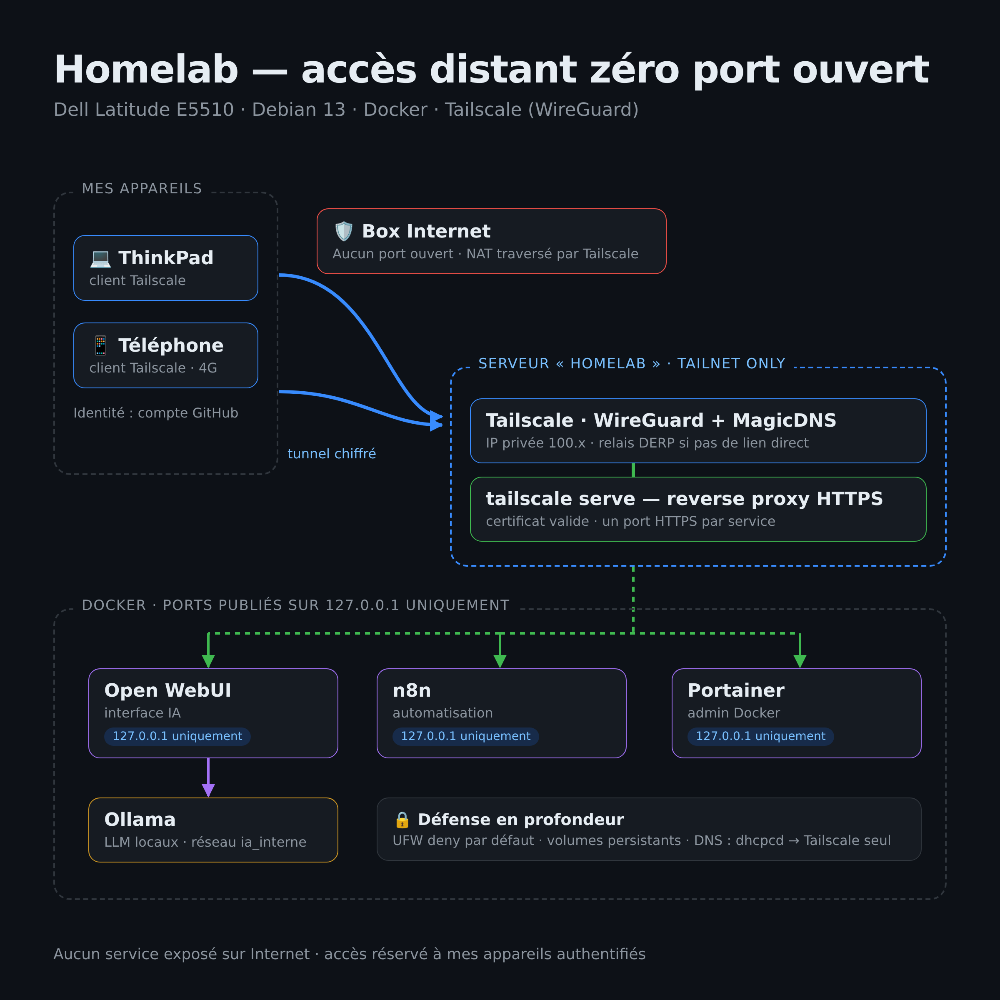

# Homelab — Infrastructure Linux et services auto-hébergés

## Présentation

Ce projet consiste à mettre en place et administrer un serveur personnel basé sur Debian GNU/Linux 13. Il sert d'environnement pratique pour expérimenter l'administration système Linux, la conteneurisation, les services réseau et l'intelligence artificielle locale.

L'objectif est de construire une infrastructure documentée, maintenable et adaptée à du matériel ancien disposant de ressources limitées.

## Matériel et système

| Élément          | Configuration                            |
| ---------------- | ---------------------------------------- |
| Machine          | Dell Latitude E5510                      |
| Processeur       | Intel Core i5 M 560, 2 cœurs / 4 threads |
| Mémoire vive     | 4 Go environ                             |
| Stockage         | SSD de 250 Go environ                    |
| Système          | Debian GNU/Linux 13 (Trixie)             |
| Architecture     | x86-64                                   |
| Conteneurisation | Docker                                   |
| Administration   | SSH, UFW, Portainer                      |
| Accès distant    | Tailscale (WireGuard), `tailscale serve` |

## Services déployés

### Intelligence artificielle locale

- **Ollama** : exécution locale de modèles de langage.
- **Open WebUI** : interface web permettant d'interagir avec les modèles disponibles via Ollama.
- **Réseau Docker dédié** : les deux services sont connectés au réseau `ia_interne`.

### Administration des conteneurs

- **Portainer CE** : interface web d'administration de l'environnement Docker.

### Automatisation

- **n8n** : plateforme d'automatisation de workflows.

### Partage de fichiers

- **Samba** : service de partage de fichiers sur le réseau local.

## Réseau et sécurité

Les premières vérifications ont identifié les mesures suivantes :

- Pare-feu UFW actif avec une politique entrante par défaut en refus.
- Accès SSH autorisé depuis le réseau local.
- Règles dédiées au partage Samba sur le réseau local.
- Open WebUI et Ollama publiés sur l'interface de boucle locale IPv4 de l'hôte.
- Portainer et n8n publiés sur l'interface de boucle locale (`127.0.0.1`).
- Accès distant via **Tailscale** (`tailscale serve`, tailnet uniquement) : aucun port ouvert sur la box. Voir [`docs/acces-distant-tailscale.md`](docs/acces-distant-tailscale.md).
- Politiques de redémarrage automatique configurées pour les conteneurs.

Les règles effectives de filtrage Docker et la configuration détaillée de l'accès SSH restent à auditer.

## Stockage et persistance

Des volumes Docker nommés ont été identifiés pour :

- les données d'Ollama ;
- les données d'Open WebUI ;
- les données de Portainer.

La stratégie de sauvegarde et la procédure de restauration restent à documenter et à tester.

## Compétences mises en pratique

- Administration d'un système Linux.
- Déploiement et gestion de conteneurs Docker.
- Organisation des réseaux de services.
- Administration distante via SSH.
- Configuration d'un pare-feu.
- Déploiement de services d'IA locale.
- Gestion des données persistantes.
- Diagnostic et documentation d'une infrastructure.

## Améliorations prévues

- Finaliser l'audit de sécurité réseau.
- Documenter l'architecture et les procédures d'exploitation.
- Définir et tester une stratégie de sauvegarde et de restauration.
- Documenter les mises à jour et la maintenance des services.
- Évaluer les performances de l'infrastructure avec ses ressources matérielles limitées.

## Documentation

- [`docs/architecture.md`](docs/architecture.md) : matériel, système, réseau Docker et architecture générale.
- [`docs/services.md`](docs/services.md) : rôle des services déployés et organisation des conteneurs.
- [`docs/acces-distant-tailscale.md`](docs/acces-distant-tailscale.md) : accès distant, choix techniques et journal de dépannage.
- [`docs/maintenance.md`](docs/maintenance.md) : mises à jour, vérifications, sauvegardes et dépannage.
- [`services/`](services/README.md) : un dossier par service (configuration et fiche d'exploitation).

La documentation distingue les éléments vérifiés des points restant à tester.
