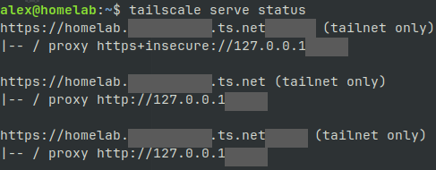
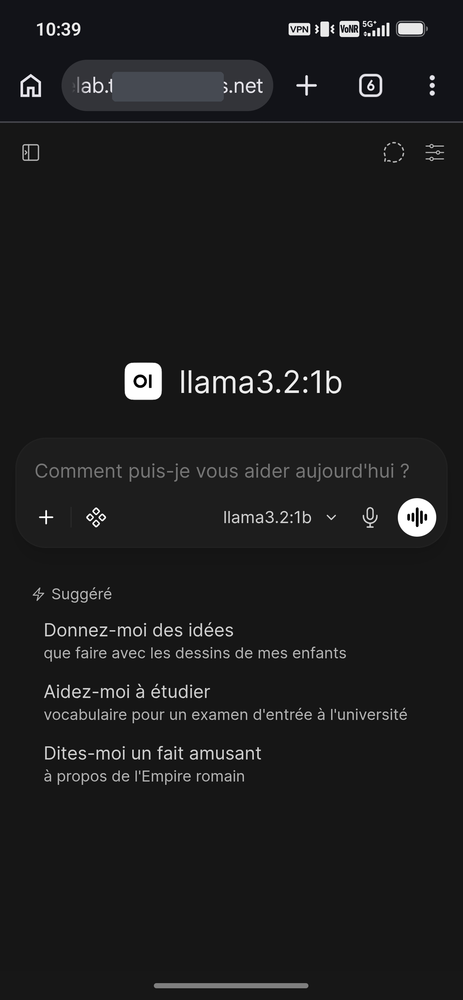
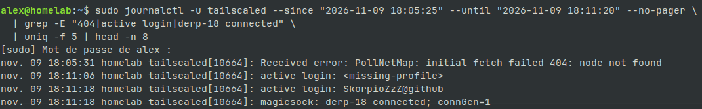

# Accès distant avec Tailscale

> Mise en place le 9 novembre 2026. Ce document explique **ce qui a été fait, pourquoi, et comment ça marche**.
> Les valeurs réelles (nom du tailnet, IP `100.x`) sont dans `prive/`, pas ici : ce dépôt est public.

## 1. Le problème de départ

Le serveur est chez moi, derrière la box. Depuis l'extérieur (école, 4G), il est injoignable : la box bloque les connexions entrantes (NAT).

La solution « classique » consiste à ouvrir des ports sur la box. Mais alors **tout Internet** peut atteindre les services, et Portainer exposé revient à donner le contrôle de Docker, donc de la machine.

**Objectif** : accéder à mes services depuis mes appareils, **sans rien exposer sur Internet**.

## 2. Les deux notions à distinguer

| | Tailscale | Reverse proxy |
|---|---|---|
| Question résolue | *Comment j'atteins la machine ?* | *Comment j'arrive sur le bon service ?* |
| Couche | Réseau (tunnel chiffré) | Application (HTTP) |
| Exemple | Le téléphone parle au serveur comme s'il était sur le même réseau local | `:8443` → n8n, `:10000` → Portainer |

Ils ne sont pas concurrents. Ici, Tailscale fournit les deux : le tunnel **et** un petit reverse proxy intégré (`tailscale serve`).

## 3. Comment fonctionne Tailscale

- Chaque appareil installe Tailscale et rejoint mon réseau privé (le **tailnet**). Il reçoit une IP en `100.x.y.z`.
- Les appareils communiquent par des tunnels chiffrés **WireGuard**, en direct quand c'est possible.
- Le serveur de coordination de Tailscale ne fait qu'échanger les clés et aider à traverser le NAT. Si la connexion directe échoue, le trafic passe par un relais chiffré (**DERP**, le plus proche est Paris).
- **Aucun port n'est ouvert sur la box.**
- **MagicDNS** permet d'utiliser des noms (`homelab`) plutôt que des IP.
- Identité : compte **GitHub**. Tout nouvel appareil doit se connecter avec ce même compte, sinon il rejoint un autre tailnet.

Appareils : `homelab` (le serveur Dell), un PC portable et un téléphone Android.

## 4. Architecture finale

```
Téléphone / ThinkPad
      │  tunnel WireGuard chiffré (Tailscale)
      ▼
Dell « homelab » ── tailscale serve (HTTPS, certificat Tailscale)
      ├── :443   ──▶ 127.0.0.1:3000 ──▶ conteneur Open WebUI (8080)
      ├── :8443  ──▶ 127.0.0.1:5678 ──▶ conteneur n8n
      └── :10000 ──▶ 127.0.0.1:9443 ──▶ conteneur Portainer (HTTPS auto-signé)
```

| Service | URL (depuis le tailnet) |
|---|---|
| Open WebUI | `https://homelab.<tailnet>.ts.net` |
| n8n | `https://homelab.<tailnet>.ts.net:8443` |
| Portainer | `https://homelab.<tailnet>.ts.net:10000` |

Tous sont marqués **`tailnet only`** : invisibles depuis Internet.





## 5. Les choix et leurs raisons

### Conteneurs publiés uniquement sur `127.0.0.1`
`127.0.0.1:3000->8080` signifie que le port n'est ouvert **que pour les programmes du Dell lui-même**. Ni le réseau local ni Tailscale ne peuvent l'atteindre directement : seul `tailscale serve`, qui tourne sur le Dell, y accède.

- **À éviter : `0.0.0.0:PORT`.** Cela ouvre le port sur toutes les interfaces, et **Docker contourne les règles UFW**.
- Alternative écartée : publier sur l'IP Tailscale (`100.x:3000:8080`). Au démarrage, si Docker démarre avant Tailscale, le conteneur échoue (« cannot assign requested address »).

### `tailscale serve` plutôt qu'un reverse proxy (Caddy, Nginx)
- HTTPS avec un vrai certificat, sans configuration.
- Aucun composant supplémentaire à maintenir.
- `--bg` rend la configuration persistante après redémarrage.
- **Limite** : seulement 3 ports HTTPS possibles (443, 8443, 10000), donc 3 services maximum. Au-delà, il faudra un vrai reverse proxy (Caddy), toujours accessible seulement via Tailscale.

### Un port par service, pas un chemin (`/n8n`)
La plupart des applications supposent être servies à la racine `/`. Sous un sous-chemin, leurs liens et redirections cassent.

### `https+insecure://` pour Portainer
Portainer sert lui-même du HTTPS avec un certificat auto-signé. `https+insecure` demande à Tailscale de ne pas vérifier ce certificat. C'est acceptable car cette connexion reste **interne à la machine** (`127.0.0.1`). Côté client, le certificat est valide.

### Funnel : refusé
**Funnel** rend un service public sur Internet. C'est l'inverse de l'objectif. À n'utiliser que pour une démo publique volontaire.

## 6. Commandes utiles

```bash
tailscale status                 # appareils du tailnet et leur état
tailscale ip -4                  # IP Tailscale de la machine
tailscale ping <appareil>        # test réseau (direct ou via DERP)
tailscale netcheck               # diagnostic réseau (UDP, NAT, relais)
tailscale serve status           # ce qui est servi
sudo tailscale serve --https=8443 off   # retirer un service
sudo tailscale serve reset       # tout retirer
sudo journalctl -u tailscaled -n 50 --no-pager   # journaux (sudo obligatoire)
```

Ajouter un service :
```bash
sudo tailscale serve --bg 3000                                        # port 443
sudo tailscale serve --bg --https=8443 5678
sudo tailscale serve --bg --https=10000 https+insecure://127.0.0.1:9443
```

## 7. Problèmes rencontrés (journal de dépannage)

C'est la partie la plus instructive : chaque problème a été diagnostiqué couche par couche, sans deviner.

### a. Le Dell n'apparaissait pas dans la console
- **Symptôme** : `tailscale status` affichait le Dell `offline`, alors que `systemctl status tailscaled` indiquait « Connected ».
- **Hypothèses écartées** : mauvais compte (tous les appareils étaient dans le même tailnet), horloge fausse (`timedatectl` synchronisé), réseau bloqué (`netcheck` OK).
- **Cause réelle**, trouvée dans les journaux : `PollNetMap: initial fetch failed 404: node not found`. La machine avait été **supprimée côté serveur** mais gardait localement son ancienne identité.
- **Correction** : `sudo tailscale up --force-reauth`, ce qui a donné une nouvelle identité et une nouvelle IP.


- **Leçon** : lire les journaux, et avec `sudo` (sans, `journalctl` affichait « No entries »).

### b. « Ce site est inaccessible » sur le téléphone
- **Erreur de compréhension** : `localhost` sur le téléphone désigne **le téléphone**, jamais le serveur.
- **Erreur de compréhension** : `http://homelab` sans port vise le port 80, où rien n'écoute. Un navigateur contacte **un service sur un port**, pas une machine.
- **Cause réelle** : `docker ps` montrait `127.0.0.1:3000->8080`, donc un port fermé à tout ce qui vient de l'extérieur du Dell.
- **Méthode** : vérifier couche par couche → service local (`curl localhost:3000` → 200) → réseau (`tailscale ping` → OK) → exposition (`docker ps`).

### c. Portainer sans aucun port publié
- `docker inspect` : `Ports {}`, lancé par `docker run` (pas Compose).
- On ne peut pas ajouter un port à un conteneur existant : il faut le **recréer**.
- **Vérification préalable indispensable** : `docker inspect portainer --format '{{json .Mounts}}'` → données dans le volume `portainer_data`, donc la recréation se fait sans perte.
- Recréé avec `-p 127.0.0.1:9443:9443`. `services/portainer/compose.yaml` reflète cette configuration.

### d. Conflit DNS (« DNS fight »)
- **Symptôme** : `resolv.conf was trampled` en boucle dans les journaux.
- **Cause** : deux programmes écrivaient `/etc/resolv.conf`. `dhcpcd` (client DHCP lancé par `ifupdown`) y mettait le DNS de la box, Tailscale y mettait `100.100.100.100` (MagicDNS).
- **Conséquence** : sur le Dell uniquement, la résolution des noms du tailnet était intermittente.
- **Correction** : ajout de `nohook resolv.conf` dans `/etc/dhcpcd.conf`. `dhcpcd` gère toujours l'IP, Tailscale seul gère le DNS et relaie les autres requêtes vers la box.
- **Retour arrière** : `sudo cp /etc/dhcpcd.conf.bak /etc/dhcpcd.conf && sudo dhcpcd -n enp11s0`.
- Alternatives écartées : `tailscale set --accept-dns=false` (plus simple, mais plus de noms du tailnet sur le serveur) ; `systemd-resolved` (plus propre, mais un composant de plus).

## 8. Points de vigilance

- [ ] **Disable key expiry** activé sur `homelab` dans la console (sinon déconnexion au bout d'environ 180 jours).
- [ ] Ne pas supprimer la machine dans la console (voir 7.a).
- [ ] Test après redémarrage : `tailscale status`, `tailscale serve status`, `docker ps`, `cat /etc/resolv.conf`.
- [ ] n8n : les URL de webhook affichent `localhost`. À corriger via `N8N_HOST`, `N8N_PROTOCOL` et `WEBHOOK_URL` si j'utilise des webhooks.
- [ ] Changement de box : `resolv.conf` ne suivra pas le nouveau DNS automatiquement (voir 7.d).

## 9. L'expliquer en 30 secondes

> « Mon serveur n'est exposé à aucun port sur Internet. J'utilise Tailscale, un VPN maillé basé sur WireGuard : mes appareils forment un réseau privé chiffré, et seuls eux peuvent joindre le serveur. Les conteneurs Docker n'écoutent qu'en local, et c'est `tailscale serve` qui fait office de reverse proxy HTTPS vers chacun d'eux. J'ai dû résoudre une identité de machine supprimée côté serveur, un problème de binding Docker et un conflit DNS entre dhcpcd et Tailscale. »
