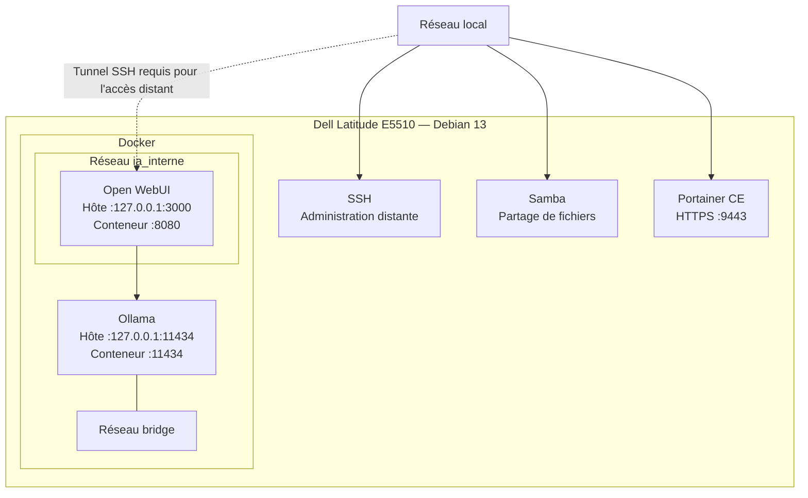

# Architecture de l'infrastructure

## Vue d'ensemble

Le homelab repose sur un Dell Latitude E5510 sous Debian GNU/Linux 13 (Trixie). Il héberge des services conteneurisés et des services système accessibles depuis le réseau local.

L'objectif est de disposer d'un environnement d'expérimentation pour l'administration Linux, Docker, les réseaux et l'intelligence artificielle locale, tout en tenant compte des ressources limitées de la machine.

## Matériel et système

- **Machine :** Dell Latitude E5510
- **Processeur :** Intel Core i5 M 560, 2 cœurs et 4 threads
- **Mémoire :** environ 3,6 Gio détectés
- **Stockage :** SSD d'environ 250 Go
- **Système :** Debian GNU/Linux 13 (Trixie)
- **Architecture :** x86-64

## Services et conteneurs

| Service      | Fonction                                | Accès réseau constaté      |
| ------------ | --------------------------------------- | -------------------------- |
| Open WebUI   | Interface web pour les modèles locaux   | Boucle locale, port 3000   |
| Ollama       | Exécution locale de modèles de langage  | Boucle locale, port 11434  |
| Portainer CE | Administration des conteneurs Docker    | Adresse LAN, port 9443     |
| Samba        | Partage de fichiers sur le réseau local | Configuration à documenter |

Open WebUI et Ollama sont connectés au réseau Docker `ia_interne`. Le fichier Compose d'Open WebUI déclare notamment son image, ses paramètres, son stockage persistant, son contrôle de santé et son réseau.

Portainer et Ollama sont également présents dans l'environnement Docker. Leur méthode exacte de déploiement doit être documentée séparément si elle diffère du fichier Compose d'Open WebUI.

## Accès et sécurité

- Le pare-feu UFW est actif.
- Les connexions entrantes sont refusées par défaut.
- Les règles identifiées autorisent SSH et Samba depuis le réseau local.
- Open WebUI et Ollama sont publiés sur l'interface de boucle locale IPv4 de l'hôte.
- Portainer est publié sur l'adresse réseau locale de l'hôte.
- Les conteneurs disposent de politiques de redémarrage automatique.

Ces éléments décrivent l'état observé pendant la documentation. Ils ne constituent pas un audit exhaustif de sécurité.

## Stockage persistant

Des volumes Docker nommés sont présents pour les données d'Ollama, d'Open WebUI et de Portainer.

La stratégie de sauvegarde, la restauration des données et les tests correspondants restent à définir.

## Schéma logique

Le schéma présente les principaux accès au serveur et les relations entre les services. Les ports indiqués correspondent aux publications observées sur l'hôte.

### Points à retenir

- Open WebUI et Ollama sont publiés sur la boucle locale IPv4 de l'hôte ; ils ne sont donc pas directement publiés sur toutes les interfaces réseau.
- Un tunnel SSH peut permettre d'accéder à Open WebUI depuis un autre ordinateur. Son fonctionnement doit être vérifié après toute modification de la configuration.
- Portainer est publié sur l'interface réseau locale du serveur, contrairement à Open WebUI et Ollama.
- Le schéma est une vue simplifiée : il ne représente pas toutes les interfaces Docker ni l'ensemble des règles de filtrage réseau.
