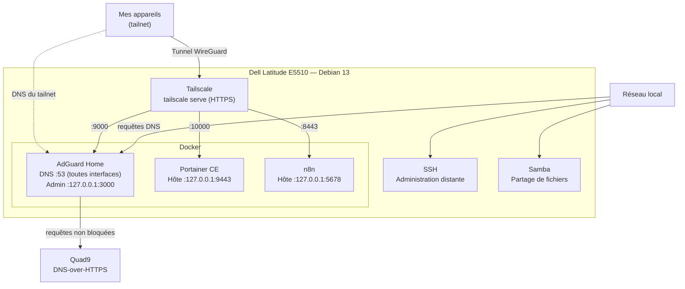

# Architecture de l'infrastructure

## Vue d'ensemble

Le homelab repose sur un Dell Latitude E5510 sous Debian GNU/Linux 13 (Trixie). Il héberge des services conteneurisés et des services système accessibles depuis le réseau local.

L'objectif est de disposer d'un environnement d'expérimentation pour l'administration Linux, Docker et les réseaux (DNS compris), tout en tenant compte des ressources limitées de la machine.

## Matériel et système

- **Machine :** Dell Latitude E5510
- **Processeur :** Intel Core i5 M 560, 2 cœurs et 4 threads
- **Mémoire :** environ 3,6 Gio détectés
- **Stockage :** SSD d'environ 250 Go
- **Système :** Debian GNU/Linux 13 (Trixie)
- **Architecture :** x86-64

## Services et conteneurs

| Service      | Fonction                                | Accès réseau constaté      |
| ------------ | --------------------------------------- | -------------------------- |
| AdGuard Home | DNS filtrant (pubs, traqueurs)          | DNS : toutes interfaces, port 53 ; admin : boucle locale, port 3000 |
| Portainer CE | Administration des conteneurs Docker    | Boucle locale, port 9443   |
| n8n          | Automatisation de workflows             | Boucle locale, port 5678   |
| Glances      | Supervision du serveur                  | Toutes interfaces, port 61208 (à restreindre) |
| Samba        | Partage de fichiers sur le réseau local | Configuration à documenter |

Chaque service déployé par Compose a son propre réseau Docker par défaut ; aucun réseau n'est partagé entre services.

Ollama, Open WebUI et leur réseau `ia_interne` ont été supprimés le 2026-11-18. n8n, qui était aussi branché sur `ia_interne`, a été détaché avant la suppression du réseau.

## Accès et sécurité

- Le pare-feu UFW est actif.
- Les connexions entrantes sont refusées par défaut.
- Les règles identifiées autorisent SSH et Samba depuis le réseau local.
- AdGuard Home publie le DNS (port 53, TCP/UDP) sur toutes les interfaces : exception volontaire, un DNS devant être joignable par les appareils. Aucun port n'est redirigé sur la box. Son interface d'administration reste sur la boucle locale.
- Glances est publié sur toutes les interfaces (port 61208) : à restreindre à la boucle locale.
- Portainer et n8n sont publiés sur l'interface de boucle locale de l'hôte.
- L'accès distant passe par Tailscale : `tailscale serve` relaie en HTTPS vers chaque service, uniquement pour les appareils du tailnet. Aucun port n'est ouvert sur la box. Voir [`acces-distant-tailscale.md`](acces-distant-tailscale.md).
- Les conteneurs disposent de politiques de redémarrage automatique.

Ces éléments décrivent l'état observé pendant la documentation. Ils ne constituent pas un audit exhaustif de sécurité.

## Stockage persistant

Des volumes Docker nommés sont présents pour les données d'AdGuard Home, de n8n et de Portainer.

La stratégie de sauvegarde, la restauration des données et les tests correspondants restent à définir.

## Schéma logique

Le schéma présente les principaux accès au serveur et les relations entre les services. Les ports indiqués correspondent aux publications observées sur l'hôte.

### Points à retenir

- Les interfaces web (AdGuard Home, n8n, Portainer) ne sont publiées que sur la boucle locale ; l'accès depuis un autre appareil passe par `tailscale serve`, réservé au tailnet.
- Seul le DNS d'AdGuard Home écoute sur le réseau local, parce que c'est son rôle.
- Le serveur lui-même n'utilise pas AdGuard (`accept-dns=false`) : il reste capable de résoudre les noms si le conteneur tombe.
- Le schéma est une vue simplifiée : il ne représente pas toutes les interfaces Docker ni l'ensemble des règles de filtrage réseau.
